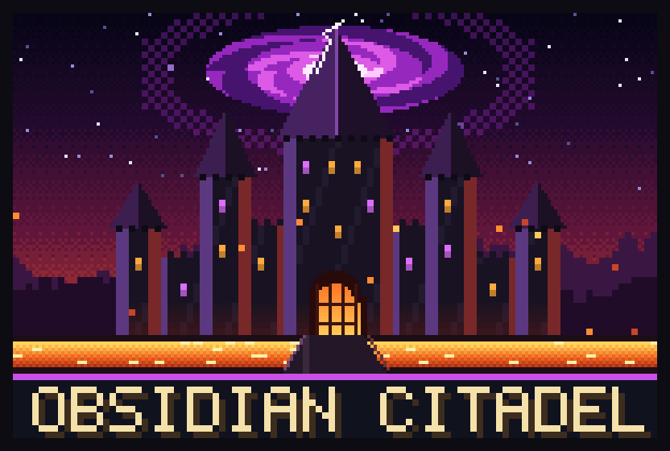

# Entwined

A classic-style creature-battling adventure that plays entirely in the terminal, with pixel-art graphics.

<p align="center">
  
  
  
</p>

You were about to be married. Then your sweetheart vanished, on the very night the Citadel's raiders were seen at the border. You know who leads them: your oldest friend, turned rival.

Choose one of six heroes, each bonded to a creature of their own nature. Walk six lands, befriend the wild creatures that will have you, battle the Lord of each land and win them to your side, then climb the Citadel together. Its masters have found a way to break the oldest rule there is, and one of them grew up beside you.

> **Early version.** The whole journey is here and it remembers your progress, but the art and writing are still rough. If you only have ten minutes, pick **A quick taste** on the title screen.

## Play it

You need **Python 3** ([download](https://www.python.org/downloads/)). Nothing else needs installing.

```sh
git clone https://github.com/j2kenton/entwined.git
cd entwined
```

Then:

| System | Run |
|---|---|
| Windows | `play` (or double-click `play.bat`) |
| Mac / Linux | `./play.sh` |

The title screen offers:

- **Begin a new journey:** the full game.
- **Carry on your journey:** appears once you've rested somewhere.
- **A quick taste:** one Lord, one floor of the Citadel and what waits at the top. About ten minutes, with no walking and nothing to learn first.

### Controls

| Key | Does |
|---|---|
| Arrow keys / WASD | Walk, and choose in menus |
| Enter / Space | Talk, look, confirm |
| Enter / Down | Move the text along |
| M | Open your pack: team, satchel, companions |
| Esc | Leave (it asks first) |

### Pictures: HD or retro

The game picks the best way to draw for your terminal:

- **HD, with real pixels.** Used when the terminal supports Sixel graphics, such as **Windows Terminal 1.22 or newer**, WezTerm or foot. Works in any window of at least **100 × 17** characters, and the picture sizes itself to the window. Press **+** and **−** to resize it.
- **Retro, with coloured text blocks.** Used everywhere else. Needs a window of at least **100 × 37** characters.

If the window is too small, the game says how to fix it, then starts by itself once it fits. To force a mode, run `play --sixel` or `play --blocks`.

## How it plays

- **Six natures**, each strong against the next: Wave → Flame → Root → Breeze → Soil → Lightning → Wave. Your road runs from the land you're strongest against to the one that's strongest against you, so it's different for every hero.
- **Wild creatures** roam the long growth off the road. Any of them will fight you; only those of your own nature will ever trust you. Wear one down, reach out, and it may join your team of up to five.
- **Towns** have an inn and a market. Resting at the inn heals your creatures and remembers your journey. The market sells remedies, tonics, charms and lures; your satchel only holds so much.
- **Each land has a Lord,** and they don't wait at the gate. Beat them and they join you, bringing their own creatures and a gift: one spots hidden paths, one brews herbs, one makes camp, and so on. If a Lord beats you, fall back and train, or let a Lord you've already won over have a go.
- **The Citadel has no rest.** Health carries from floor to floor. On each floor one of your companions faces their own nemesis, and you choose who steps in when a team falls or when the nemesis brings out something unexpected. Between floors the way is barred, and it takes the right nature to clear it.
- **Companions fight their own battles,** but they'll suggest a move and wait for your say. Press Enter to agree, or pick another.

Your journey is kept in a file called `journey.json`, in a folder named `.entwined` in your home folder. Delete it to forget the journey.

## Under the hood

For anyone curious, or wanting to change things:

| Path | What it is |
|---|---|
| [ENTWINED_DESIGN.md](ENTWINED_DESIGN.md) | The design: world rules, element chart, cast, story, and what's planned |
| `game/` | The game (`python -m game`) |
| `game/data/` | Everything editable without touching code: the element chart, creatures and moves, heroes, all the story text, and the balance numbers |
| `python -m game.sim` | Simulates the battles for every hero, to check the balance |
| `tools/playtest.py` | A robot that plays the whole game for every hero, to catch errors |
| `tools/tune.py` | Searches for Lord and Citadel levels that give the intended difficulty |
| `tools/element_wheel.py` | Prints the element chart and checks it still suits the story |
| `tools/termcheck.py` | Shows what your terminal reports (size, Sixel support) |
| `prototype/` | The first experiments: concept art, a battle clip and a one-battle demo |

To jump to a later part without playing up to it (your saved journey is left alone):

```sh
play --hero kael --from 3          # start in the third land, with the party you'd have by then
play --hero juno --from citadel    # start at the foot of the Citadel
play --hero rowan --from top       # start at the final floor
play --trial                       # straight to the quick taste
```

Everything uses only Python's standard library.
