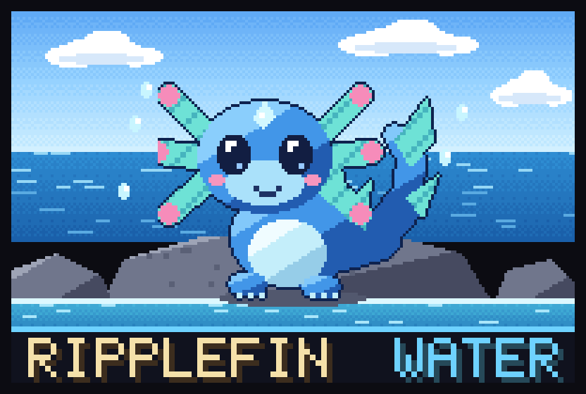

# Entwined

A classic-style creature-battling adventure that plays entirely in the terminal, with pixel-art graphics.

<p align="center">
  
  
  
</p>

You were about to be married. Then your sweetheart vanished, on the very night the Citadel's raiders were seen at the border. You know who leads them: your oldest friend, turned rival.

Choose one of six heroes, each bonded to a creature of their own nature. Cross five lands, battle the Lord of each one and win them to your side, then climb the Citadel together. Its masters have found a way to break the oldest rule there is, and one of them grew up beside you.

> **Early version.** You can play the whole story from start to finish, but it's short, and the art and writing are placeholders. There's no saving yet, so it's one sitting.

## Play it

You need **Python 3** ([download](https://www.python.org/downloads/)). Nothing else needs installing.

```sh
git clone https://github.com/j2kenton/entwined.git
cd entwined
```

Then:

| System | Run |
|---|---|
| Windows | `play` (or double-click `play.bat`) |
| Mac / Linux | `./play.sh` |

Or run it directly: `python -m game`

### Pictures: HD or retro

The game picks the best way to draw for your terminal:

- **HD, with real pixels (Sixel).** Used when the terminal supports Sixel graphics, such as **Windows Terminal 1.22 or newer**, WezTerm or foot. Works in any window of at least **100 × 17** characters, and the picture sizes itself to the window. Press **+** and **−** to resize it.
- **Retro, with coloured text blocks.** Used everywhere else. Needs a window of at least **100 × 37** characters.

If the window is too small, the game says how to fix it, then starts by itself once it fits. To force a mode, add `--sixel` or `--blocks`. If the game picks the wrong one, `python tools/termcheck.py` shows what your terminal reports.

### Controls

| Key | Does |
|---|---|
| Arrow keys / WASD | Choose |
| Enter / Space | Confirm |
| Enter / Down | Move the text along |
| Esc | Quit |

### Shortcuts for trying things out

```sh
play --hero kael                  # skip the opening and play as Kael
play --hero juno --from citadel   # start at the Citadel, with all five allies
play --hero rowan --from top      # start at the final floor
```

## How it plays

- **Six natures**, each strong against the next: Wave → Flame → Root → Breeze → Soil → Lightning → Wave. The order you cross the lands depends on your hero, from the Lord you're strongest against to the one who's strongest against you.
- **Beat a Lord and they join you.** If a Lord beats you, try again, or let an ally you've already won over have a go.
- **The Citadel has no rest.** Health carries from floor to floor. On each floor an ally faces their own nemesis, and you choose who steps in when a creature falls, or when the nemesis brings out something unexpected.
- **Ally fights:** the ally suggests a move. Press Enter to accept it, or pick another.
- **Lose a floor** and you can retry it, go back down a floor, or start the Citadel again fully rested.

## What's here

| Path | What it is |
|---|---|
| [ENTWINED_DESIGN.md](ENTWINED_DESIGN.md) | The game design: world rules, element wheel, cast, story, and what's planned |
| `game/` | The game. `python -m game` |
| `game/data/` | Everything editable without touching code: the element chart, creatures and moves, heroes, all the story text, and the balance numbers |
| `game/sim.py` | Balance check: `python -m game.sim` simulates the campaign for every hero |
| `tools/playtest.py` | A robot that plays the whole game for every hero, to catch errors |
| `tools/element_wheel.py` | Prints the element chart and checks it still suits the story |
| `tools/termcheck.py` | Shows what your terminal reports (size, Sixel support) |
| `prototype/` | The earlier experiments: concept art, a battle clip and a one-battle demo |

Everything uses only Python's standard library.
