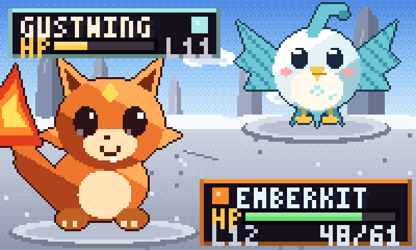
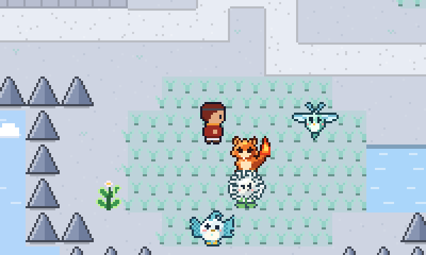
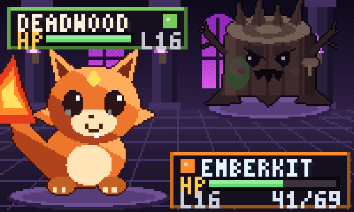
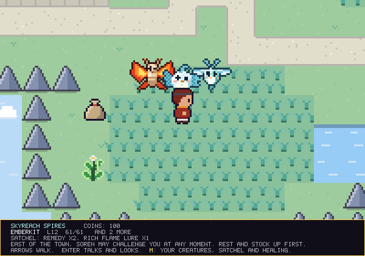
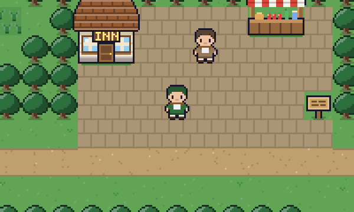
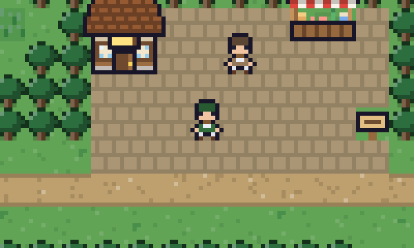

# Entwined

A classic-style creature-battling adventure that plays entirely in the terminal, with pixel-art graphics.

<p align="center">
  
  
  
</p>

<p align="center">
  
</p>

You were about to be married to the Master of the Citadel. Then word came down the road: the Citadel has fallen, with your sweetheart inside. You know who leads the six who took it: your oldest friend, turned rival.

Choose one of six heroes, each bonded to a creature of their own nature. Walk six lands, befriend wild creatures, battle the Master of each land and win them to your side, then climb the Citadel together. The six inside have done something everyone knew was impossible, and one of them grew up beside you.

> **Early version.** The whole journey is here and it remembers your progress, but the art and writing are still rough. If you only have ten minutes, pick **A quick taste** on the title screen.

> **For pictures like the ones above, the terminal matters.** They come from the game's HD mode, which needs a terminal that can draw real pixels:
>
> - **Windows:** Windows Terminal, version 1.22 or newer. (Update it from the Microsoft Store if yours is older. The old console window won't do.)
> - **Mac:** iTerm2 or WezTerm. (The Terminal app that comes with the Mac won't do.)
> - **Linux:** WezTerm, foot or Konsole.
>
> In any other terminal the game still plays, start to finish, but in a much coarser "retro" look. [See the difference below.](#pictures-hd-or-retro)

## Play it

You need **Python 3** ([download](https://www.python.org/downloads/)). Nothing else needs installing.

```sh
git clone https://github.com/j2kenton/entwined.git
cd entwined
```

Then:

| System | Run |
|---|---|
| Windows | `play` (or double-click `play.bat`) |
| Mac / Linux | `./play.sh` |

The title screen offers:

- **Begin a new journey:** the full game.
- **Carry on your journey:** appears once you've rested somewhere.
- **Go back to an earlier rest point:** appears once you have more than one.
- **A quick taste:** one Master, one floor of the Citadel and what waits at the top. About ten minutes, with no walking and nothing to learn first.

### Controls

| Key | Does |
|---|---|
| Arrow keys / WASD | Walk, and choose in menus |
| Enter / Space | Talk, look, confirm |
| Enter / Down | Move the text along |
| M | Open your pack: team, satchel, companions |
| Esc | Leave (it asks first) |

### Pictures: HD or retro

The game picks the best way to draw for your terminal, and the difference is large. This is the same spot in both:

<p align="center">
  
  
</p>
<p align="center"><em>Left: HD. Right: retro.</em></p>

- **HD, with real pixels.** Used when the terminal supports Sixel graphics: **Windows Terminal 1.22 or newer**, iTerm2, WezTerm, foot, Konsole and a few others. Works in any window of at least **100 × 17** characters, and the picture sizes itself to the window. Press **+** and **−** to resize it.
- **Retro, with coloured text blocks.** Used everywhere else, including the Mac's own Terminal app, the old Windows console, GNOME Terminal, Alacritty and kitty. It has a quarter of the detail. Needs a window of at least **100 × 37** characters.

Not sure which you'll get? In retro mode the title screen says so. `python tools/termcheck.py` shows what your terminal reports.

If the window is too small, the game says how to fix it, then starts by itself once it fits. To force a mode, run `play --sixel` or `play --blocks`.

## How it plays

- **Six natures**, each strong against the next: Wave → Flame → Root → Breeze → Soil → Lightning → Wave. Your road runs from the land you're strongest against to the one that's strongest against you, so it's different for every hero.
- **Wild creatures** roam the long growth off the road. Any of them will fight you, which is how your creatures grow: only the ones that take part in a fight learn from it.
- **Befriending.** A wild creature will only join a master of its own nature. Wear it down, then offer a lure. The weaker it is and the tastier the lure, the likelier it accepts. Each team holds up to five.
- **Towns** have an inn and a market. Resting at the inn heals everyone. The market sells remedies, tonics, charms and elixirs, and lures for the creatures of that land, in three grades. Your satchel only holds so much.
- **Each land is kept by a Master of its nature,** and they don't wait at the gate. Beat them and they join you with their own creatures and a gift: one spots hidden paths, one brews herbs, one makes camp, and so on. The first you meet has a single creature; the last has five. Once a Master is with you, the creatures of their nature will listen to them, so their team can grow too.
- **Anyone in your party can take a fight.** When you meet a wild creature or a Master, you choose whose team goes in. Companions fight their own battles, but they'll suggest a move and wait for your say. Press Enter to agree, or pick another.
- **A healing touch.** Each master can mend creatures of their own nature a few times between rests. It can't wake one that has fainted; only a rest does that.
- **Borders open both ways.** You can always walk back to a land you've already crossed, to train or to befriend.
- **The Citadel has no rest and no way out.** On each floor one of your companions faces their own nemesis, who keeps more creatures the higher you climb. Whatever the nemesis sends out, their old friend must meet first; after that anyone can step in. Between floors there's time to use your satchel and your healing touches, and nothing else. The Citadel doesn't wait for you to be ready, though a companion will say so if they think you aren't.

**Rest points.** The game remembers one rest point for each land and one for each floor of the Citadel. Arriving makes it; resting there again replaces it. You can go back to an earlier one from the title screen, or after losing a floor. They're kept in a file called `journey.json`, in a folder named `.entwined` in your home folder. Delete it to forget the journey.

## Under the hood

For anyone curious, or wanting to change things:

| Path | What it is |
|---|---|
| [ENTWINED_DESIGN.md](ENTWINED_DESIGN.md) | The design: world rules, element chart, cast, story, and what's planned |
| `game/` | The game (`python -m game`) |
| `game/data/` | Everything editable without touching code: the element chart, creatures and moves, heroes, all the story text, and the balance numbers |
| `python -m game.sim` | Simulates the battles for every hero, to show how hard each part is for parties of different strengths |
| `tools/playtest.py` | A robot that plays the whole game for every hero, to catch errors |
| `tools/tune.py` | Shows how hard the Citadel would be at different levels |
| `tools/element_wheel.py` | Prints the element chart and checks it still suits the story |
| `tools/termcheck.py` | Shows what your terminal reports (size, Sixel support) |
| `prototype/` | The first experiments: concept art, a battle clip and a one-battle demo |
| `screens/` | The pictures and the clip at the top of this page, drawn by the game's own code |
| `tools/clip.py` | Records that clip again, by playing the real game with scripted key presses |

To jump to a later part without playing up to it (your saved journey is left alone):

```sh
play --hero kael --from 3          # start in the third land, with the party you'd have by then
play --hero juno --from citadel    # start at the foot of the Citadel, with a trained party
play --hero willow --from top       # start at the final floor
play --trial                       # straight to the quick taste
```

**Trying the game out?** Start it with `play --test` and press **T** at any time for the tester's dials. Choose who a change applies to (everyone, one master, or the creature facing you in a fight), then nudge one thing at a time up or down: level, health, healing touches, coins, or the satchel. So you can make a fight easier, or harder. It works alongside the other options, for example `play --test --hero kael --from citadel`.

Everything uses only Python's standard library.
