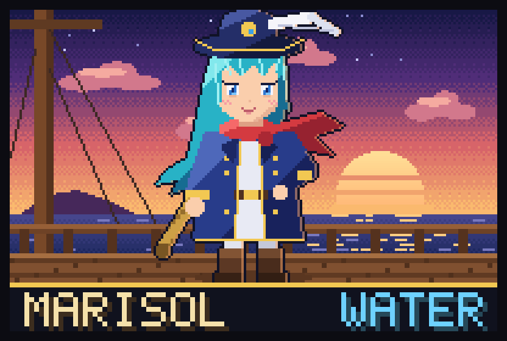

# Entwined

A classic-style creature-battling adventure that plays entirely in the terminal, with pixel-art graphics.

<p align="center">
  
  
  
</p>

Two childhood friends, too alike to stay friends, become rivals for the same sweetheart. Everyone believes a person can only ever bond with one kind of creature, until the villains find a way around that rule. To stop them, you have to cross five lands, win over each land's Lord, and storm the Citadel together.

> **Status: early prototype.** Right now you can play one battle: Ripplefin against Kael, Lord of Ember Peaks. The full game design is in [ENTWINED_DESIGN.md](ENTWINED_DESIGN.md).

## Play it

You need **Python 3** ([download](https://www.python.org/downloads/)). Nothing else needs installing.

```sh
git clone <this repo's URL>
cd <the folder it created>
```

Then:

| System | Run |
|---|---|
| Windows | `play` (or double-click `play.bat`) |
| Mac / Linux | `./play.sh` |

Or run it directly: `python prototype/play.py`

### HD mode (real pixels)

```sh
play --sixel            # Windows
./play.sh --sixel       # Mac / Linux
```

This draws the HD art with real pixels using **Sixel** graphics. It needs a terminal that supports Sixel, such as **Windows Terminal 1.22 or newer**, WezTerm or foot. Press **+** and **−** to resize the picture.

### Controls

| Key | Does |
|---|---|
| Arrow keys / WASD | Choose a move |
| Enter / Space | Confirm |
| Enter / Down | Move the text along |
| Esc | Quit |

### Window size

The normal version needs a terminal at least **100 × 36** characters, and HD mode needs **100 × 16**. If the window is too small, the game tells you how to fix it, then starts by itself once it fits.

## What else is here

| Path | What it is |
|---|---|
| [ENTWINED_DESIGN.md](ENTWINED_DESIGN.md) | The game design: world rules, element wheel, cast, story, and the plan for the first full version |
| `prototype/play.py` | The playable battle |
| `prototype/battle.py` | A scripted battle clip: `python prototype/battle.py` (add `--gif` to record it as a GIF) |
| `prototype/show.py` | The concept art in your terminal: `python prototype/show.py` (add `--hd` for the high-resolution version) |
| `prototype/images/` | The concept art and the battle clip as image files |
| `tools/element_wheel.py` | The element chart, plus checks that it still suits the story for every hero |

Everything uses only Python's standard library.
